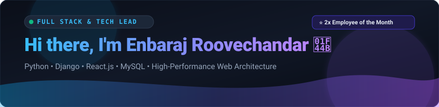

<div align="center">
  
</div>

<div align="center">
  <a href="https://readme-typing-svg.demolab.com?font=Fira+Code&size=19&duration=3000&pause=1000&color=61DAFB&center=true&vCenter=true&width=750&lines=Full+Stack+Developer+%26+Technical+Lead;Architecting+Enterprise+Web+Platforms;Python+%E2%80%A2+Django+%E2%80%A2+React.js+%E2%80%A2+MySQL;Certified+Python+%26+Advanced+SQL+%40+HackerRank">
    
  </a>
</div>

<br/>

### 👨‍💻 About Me

```python
class Enbaraj:
    def __init__(self):
        self.role = "Full Stack Developer & Technical Team Lead"
        self.company = "Karanodaka Pvt Ltd"
        self.honors = ["2x Employee of the Month (Q1 & Q2)"]
        self.passions = ["Clean Architecture", "Sub-500ms Frontends", "Scalable APIs"]

    def current_focus(self):
        return {
            "enterprise": "Directing 15-member engineering squad on SafeNod",
            "open_source": "MousePilot (Python desktop automation operating under 15MB RAM)",
            "gaming_collab": "The Miscreant Studios Web Platform",
            "certifications": ["HackerRank Python (Basic)", "HackerRank SQL (Advanced)"]
        }
```

- 🔭 **Technical Team Lead @ Karanodaka**: Spearheading engineering sprints, code reviews, and architecture for enterprise security platforms.
- ⚡ **Performance-Obsessed**: Specializing in sub-500ms dashboard latencies, reusable React component systems, and resilient Python/Django backends.
- 🏆 **Recognitions**: Awarded *Employee of the Month* twice (Q1 & Q2 2026) for engineering delivery and architectural ownership.
- 📜 **Verified Certifications**:
  - 🥇 [SQL (Advanced) Certification](https://www.hackerrank.com/certificates/0e7d94bacbcf) — HackerRank (`0E7D94BACBCF`)
  - 🐍 [Python (Basic) Certification](https://www.hackerrank.com/certificates/4b7a0ef6cdb2) — HackerRank (`4B7A0EF6CDB2`)
  - 🎓 Full Stack Python Development (500+ Hours) — Besant Technologies

---

### 🛠️ Tech Arsenal & Stack

| Category | Technologies |
| :--- | :--- |
| **Languages** |      |
| **Frameworks & Libraries** |    |
| **Databases** |   |
| **Architecture & Tools** |      |

---

### 🚀 Highlighted Collaborations & Projects

<table>
  <tr>
    <td width="50%" valign="top">
      <h3 align="left">🚀 <a href="https://github.com/itsenbaraj/mousepilot">MousePilot</a></h3>
      <p>Open-source Python desktop automation utility with multi-threaded trajectory calculations operating under 15MB RAM footprint.</p>
      <p>
        
        
        
      </p>
    </td>
    <td width="50%" valign="top">
      <h3 align="left">🌐 <a href="https://github.com/itsenbaraj/mousepilot-website">MousePilot Official Website</a></h3>
      <p>Official product landing page and distribution hub for MousePilot, engineered with responsive layout geometry and modern UX.</p>
      <p>
        
        
      </p>
    </td>
  </tr>
  <tr>
    <td width="50%" valign="top">
      <h3 align="left">🎮 The Miscreant Studios</h3>
      <p>Co-engineered gaming studio web platform featuring interactive game assets, immersive studio showcase, and modern responsive frontend engineering.</p>
      <p>
        
        
      </p>
    </td>
    <td width="50%" valign="top">
      <h3 align="left">🛡️ SafeNod (Enterprise Platform)</h3>
      <p>Directed end-to-end frontend architecture for enterprise security & client management platform. Engineered token-based sessions and 5,000+ client record data tables.</p>
      <p>
        
        
      </p>
    </td>
  </tr>
</table>

---

### 📊 Engineering Stats & Activity

<div align="center">
  
  
</div>

<div align="center">
  
</div>

---

### 🤝 Connect & Collaborate

<p align="center">
  <a href="https://linkedin.com/in/itsenbaraj" target="_blank">
    
  </a>
  &nbsp;
  <a href="https://www.hackerrank.com/certificates/0e7d94bacbcf" target="_blank">
    
  </a>
  &nbsp;
  <a href="https://www.hackerrank.com/certificates/4b7a0ef6cdb2" target="_blank">
    
  </a>
  &nbsp;
  <a href="mailto:itsenbaraj@gmail.com">
    
  </a>
</p>
